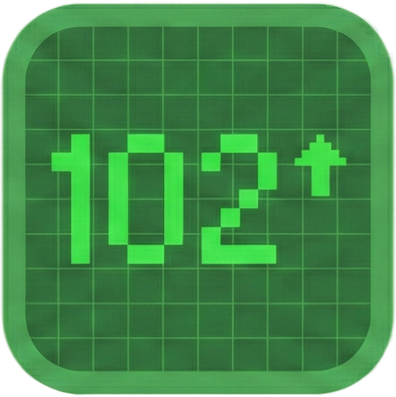

<p align="center">
  
</p>

<h1 align="center">SugarClock (Sugar Clock)</h1>

<p align="center">
  Turn a $40 pixel clock into a real-time glucose display for your desk, nightstand, or kitchen counter.
</p>

<p align="center">
  <a href="https://sugarclock.com/">Website</a> &bull;
  <a href="#quick-start">Quick Start</a> &bull;
  <a href="https://sugarclock.com/#install">Setup Guide</a> &bull;
  <a href="https://sugarclock.com/faq.html">Help & FAQ</a>
</p>

> [!WARNING]
> **SugarClock is not a medical device.** It is an unofficial DIY project and is not affiliated with or endorsed by Dexcom, Abbott, Nightscout, or Ulanzi. Readings can be delayed or missing, and the clock may not sound alerts when its data is stale. Do not use SugarClock for treatment decisions or as a replacement for your CGM's own alarms; always confirm with your CGM receiver, app, or blood glucose meter.

---

## What is SugarClock?

SugarClock (Sugar Clock) is free, open-source firmware that turns the [Ulanzi TC001 Smart Pixel Clock](https://amzn.to/4rrqbjz) into a dedicated CGM (continuous glucose monitor) display. Over WiFi, it connects to **Dexcom Share**, **FreeStyle Libre** via LibreLinkUp, or a compatible custom JSON adapter for **Nightscout** and shows your current glucose reading in big, color-coded numbers on an LED matrix.

**Cost:** ~$40 one-time for the clock. The software is free. No subscriptions.

## Connection guides

- [Dexcom Share blood sugar clock](https://sugarclock.com/dexcom-blood-sugar-clock.html)
- [FreeStyle Libre display via LibreLinkUp](https://sugarclock.com/freestyle-libre-display.html)
- [Nightscout via a custom JSON adapter](https://sugarclock.com/nightscout-clock.html) — advanced setup; raw Nightscout entries need conversion.

## Availability

This README describes source on `main`; published firmware and bundled installers can differ. **Checked November 8, 2026:**

- The newest published stable firmware is [v0.2.18](https://github.com/cdemeke/SugarClock/releases/tag/v0.2.18), published October 25. GitHub's `/releases/latest` currently points to the older [v0.2.13](https://github.com/cdemeke/SugarClock/releases/tag/v0.2.13), so use the explicit release links when checking versions.
- The [browser installer manifest](docs/manifest.json) and [bundled firmware metadata](docs/installer-artifacts.json) identify **v0.2.15**. The Mac setup app's bundled firmware matches that version too. LibreLinkUp, all seven pixel companions, the redesigned dashboard, and the mmol/L display fix shipped in v0.2.13 and are included in v0.2.15; they are no longer source-only features.
- Neither v0.2.18 nor the release currently selected by `/releases/latest` has a Mac DMG asset. Use the browser installer or build from source. The [Mac setup app source](onboarding/TC001Setup) remains available for developers.

Newer source capabilities, including the [iPhone companion](#iphone-companion-firmware-030--protocol-1), have separate firmware and distribution requirements. Do not assume they are included in these released installer images.

## Features

- **Live glucose display** — Large color-coded numbers (green = in range, orange = high/low, red = urgent)
- **Trend arrows** — See which direction your glucose is heading
- **Dexcom, Libre & Nightscout** — Reads Dexcom Share or LibreLinkUp over WiFi, or a Nightscout adapter returning the supported custom JSON format; the clock does not connect directly to the sensor
- **mg/dL or mmol/L** — Readings and deltas use your selected units on the clock and dashboard; mmol/L displays one decimal place
- **Demo mode** — Explore the display with synthetic readings without a CGM account
- **Stale reading color** — Old readings switch to the stale color (dim purple by default, configurable in Settings → Colors) while keeping the last number and arrow visible. The default cutoff is seven minutes; longer polling intervals add time for delivery. Fresh data restores the usual color, and a shorter configured stale timeout takes precedence.
- **Low glucose focus** — Enable “Show Only Blood Sugar When Low” in Settings → Display to keep the glucose value visible below the configured Low threshold (including urgent lows). It blocks other screens and navigation while readings are fresh. Notifications (including urgent ones) are hidden and may expire unseen; they are not deferred. Normal behavior resumes after recovery, stale data, repeated glucose fetch failures, or entry into Wi-Fi setup mode. Brief Wi-Fi drops and failed network checks do not hide a fresh low reading. Off by default.
- **Audible alerts** — Buzzer for high/low glucose with snooze button
- **Auto brightness** — Built-in light sensor adjusts to your room
- **Night mode** — Dims automatically during sleeping hours
- **Web dashboard** — Live LED mirror, latest glucose reading, delta, and age, plus settings from your phone or computer browser
- **Secure WiFi updates** — Signed, power-loss-safe firmware updates with automatic rollback
- **Clock, weather & more** — Also shows time, date, temperature, pomodoro timer, and push notifications
- **Compact weather animations** — A dedicated pixel icon sits beside the temperature: looping clouds, falling rain, straight-falling snowflakes, and a small lightning bolt. Clear skies use a static sun. [See the display design](docs/images/weather-side-animation-design.png).
- **Pixel Companions** — Choose Pip the goldfish, Boo the ghost, Mochi the axolotl, Sprout the dinosaur, Pebble the turtle, Inky the octopus, or Maple the red panda in Settings → Display. Choose companion + text, companion + range icon, or the companion alone centered on screen. Preview low, in-range, and high poses; range text/icons use red for both low and high by default, with an option to follow your configured glucose colors. Greetings and sleepy poses apply only in range. The clock remembers your choices, and urgent readings replace the companion with the glucose number.

## Video demo studio

Try the virtual 32×8 SugarClock in [`docs/demo/`](docs/demo/README.md): glucose presets, seven pixel companions, animated weather, live timers, display rotation, and physical-button interactions. Includes a controls-free filming view and runs locally without a device or account.

## What You Need

| Item | Notes |
|------|-------|
| [Ulanzi TC001 pixel clock](https://amzn.to/4rrqbjz) | ~$40 on Amazon |
| USB-C data cable | Usually included with the clock |
| A computer | Chrome/Edge for browser installation; command-line builds work across platforms |
| WiFi (2.4 GHz) | The clock connects to your home WiFi |
| Dexcom Share account, LibreLinkUp follower account, or compatible JSON URL | Nightscout requires an adapter; demo mode needs no CGM account |

### FreeStyle Libre setup

Libre support uses the unofficial LibreLinkUp follower API and requires readings shared to that account. Save its credentials in Settings, then use
**Test Connection** to load the people sharing with it. A single person is saved
automatically. If several people share, choose **Person to display** and save.
The clock remembers the person's ID across restarts and stops accepting readings
if that person stops sharing; it never substitutes another person. Changing the
Libre email clears the saved person and detected region, including during Mac setup.

Libre readings require synchronized network time and a valid sensor timestamp
no more than ten minutes old. Test Connection follows the same retry limits as
automatic polling: requests are at least 15 seconds apart, and authorization
rejections back off from five minutes to one hour. A network error during a retry
preserves that cooldown. Saving changed credentials allows a new attempt.
Requests to accept terms, privacy policies, or verify an account retry every
five minutes for the first hour, then back off to 10, 20, 40, and at most 60
minutes. After completing the action in LibreLinkUp, test again once the current
cooldown expires; Test uses the same retry limit as automatic polling.

### Custom URL and Nightscout compatibility

**Custom URL** reads a JSON object with `glucose` in mg/dL, a sensor `timestamp` in UTC Unix seconds, and `trend` (for example, `Flat`, `SingleUp`, or `SingleDown`). An optional token is sent as `Authorization: Bearer <token>`. Preserve the sensor timestamp across repeated polls so reading age remains accurate; see the [full format and timestamp rules](INSTALL.md#required-configuration).

A Nightscout site root or standard entries response is **not directly supported**. Use an adapter that returns the expected object and handles Nightscout authentication. The Mac setup app's Nightscout option saves the site root as a Custom URL; that alone is insufficient. See the [Nightscout adapter guide](https://sugarclock.com/nightscout-clock.html).

## Quick Start

For a configured clock, follow the [preservation and migration guide](docs/BLE_MIGRATION.md) before any USB installation. The browser installer can erase settings; these steps are for a fresh installation.

1. Connect your Ulanzi TC001 to a computer with a USB-C **data** cable.
2. Open the [browser installer](https://sugarclock.com/#install) in Chrome or Edge and follow its prompts. It installs the bundled version listed in **Availability** above.
3. For first-time WiFi setup, join the **SugarClock-Setup** network from a phone or computer, open `http://192.168.4.1` in a normal browser, and use **WiFi → Join this network**.
4. Once connected, open the clock's local address from a device on the same network to configure your data source, units, ranges, and display. **Double-click the middle button** to show that address.

See the [installation guide](INSTALL.md) for detailed flashing, WiFi setup, school/WPA2-Enterprise setup, and recovery instructions.

<details>
<summary><strong>Advanced: Build from source (all platforms)</strong></summary>

For a fresh installation from current source (all platforms):

```bash
git clone https://github.com/cdemeke/SugarClock.git
cd SugarClock
python3 -m pip install -r requirements-build.txt
pio run && pio run --target buildfs      # build firmware + filesystem
pio run --target upload                   # flash firmware
pio run --target uploadfs                 # flash filesystem
```

Use the first-time WiFi steps above; no source-code credential edits are needed. Open `http://<device-ip>/` for Settings, or use `pio device monitor` to find the IP. For a configured clock, use the [preservation and migration procedure](INSTALL.md#one-time-otabluetooth-migration-preserve-existing-settings) instead of flashing a fresh filesystem.

You may need the [CH340 USB driver](https://sparks.gogo.co.nz/ch340.html) on Windows.

</details>

## Clock Buttons

- **Tap right:** next screen. On the timer or stopwatch, starts or pauses it.
- **Tap left:** previous screen.
- **Tap middle:** cycle brightness.
- **Double-click middle:** show the clock's local browser address.
- **Hold right on a Pixel Pet for one second:** the ghost waves or the fish reacts. Release and hold again to repeat.

## Firmware Updates

Version 0.2.0 is the one-time OTA bootstrap release. Install it once over USB so the new
two-slot partition table is present. After that, normal stable releases are checked nightly
over WiFi and installed without the Mac app or USB cable. Existing WiFi, Dexcom, Nightscout,
alert, and display settings remain in NVS during the migration and future updates.

Open the device's **Device** page to check manually, install an available update, enable or
disable automatic installs, or choose the local install hour. Automatic installation is
deferred for low battery, urgent glucose/notifications, an active buzzer or timer, setup/AP
mode, low heap, unavailable time, or lost WiFi. Manifest checks and firmware downloads use
certificate-validated HTTPS, and every release manifest is verified with the public release
key compiled into the firmware.

The running firmware writes updates to the inactive application slot. The new firmware must pass a
15-second local health check before it is marked valid; a crash, watchdog reset, or failed
health check causes the bootloader to restore the previous slot. Internet and CGM availability
are deliberately not part of that health check.

USB flashing remains the recovery path. See [INSTALL.md](INSTALL.md) for the non-erasing
bootstrap migration and recovery commands. Maintainers should follow
[docs/OTA_SIGNING.md](docs/OTA_SIGNING.md) for release signing and key rotation.

For fleet setup, enrollment, remote commands, managed updates, and reporting/privacy behavior, see the [fleet service documentation](fleet/README.md).

Companion integrations: see the [configuration API and legacy-field migration notes](docs/companion-api.md).

## Troubleshooting

| Problem | Solution |
|---------|----------|
| Clock not detected via USB | Use a data cable (not charge-only), connect directly (no hub), install CH340 driver |
| Upload fails | Hold middle button while plugging in USB to enter flash mode |
| `NO WIFI` on display | Check SSID/password, make sure it's a 2.4 GHz network |
| `NO DATA` on display | Check source credentials, Libre person selection, or the custom endpoint format in Settings |
| Reading uses the stale color | Check connectivity and the source's reading age; the default color is dim purple on current source |
| Cannot find local Settings | Double-click the middle button, or check your router or serial monitor |
| Latest features are missing | Compare the installed firmware version with Availability above; source and installer versions differ |

See the **[Help & FAQ](https://sugarclock.com/faq.html)** for more.

## Backup & Restore Factory Firmware

```bash
# Backup original firmware (before flashing)
esptool.py -p /dev/cu.usbserial-* -b 921600 read_flash 0x0 ALL tc001_factory_backup.bin

# Restore original firmware
esptool.py -p /dev/cu.usbserial-* -b 460800 write_flash 0x0 tc001_factory_backup.bin
```

## Acknowledgments

- [AWTRIX3](https://blueforcer.github.io/awtrix3/#/) — LED matrix firmware for the TC001 that inspired this project
- [pydexcom](https://github.com/gagebenne/pydexcom) — Dexcom Share API reference
- [nightscout-librelink-up](https://github.com/timoschlueter/nightscout-librelink-up) — LibreLinkUp API reference
- [OpenWeatherMap](https://openweathermap.org/) — Free weather API

## License

Released under the [MIT License](LICENSE).

## iPhone companion (firmware 0.3.0 / protocol 1)

The native [iOS companion source and build instructions](ios/README.md) support BLE
pairing, saved clocks, settings, clock-side Wi-Fi trials and existing signed Wi-Fi OTA.
See the [protocol specification](protocol/SUGARCLOCK_BLE_V1.md),
[preservation migration paths](docs/BLE_MIGRATION.md), and
[physical acceptance checklist](docs/BLE_ACCEPTANCE.md). Hardware qualification and
Apple signing remain required before distribution; no release is published by this change.
