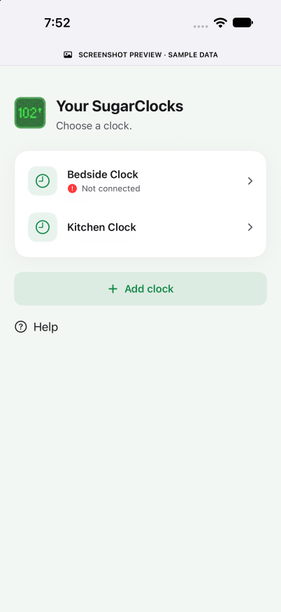
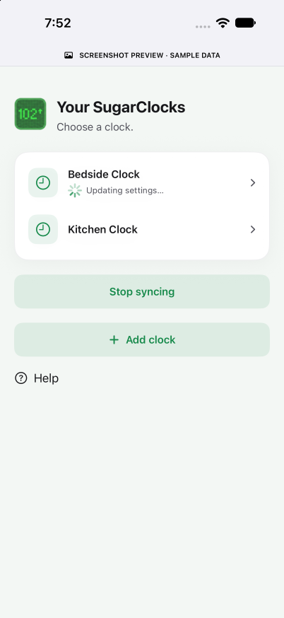

# Build 28 connection statuses

Actual production SwiftUI views captured on the iPhone 18 Pro simulator (iOS 27.0), November 1, 2026. Each image is labeled **SCREENSHOT PREVIEW · SAMPLE DATA**. These captures verify copy and layout, not physical Wi-Fi or Bluetooth connectivity.

| Not connected | Searching | Updating settings |
| --- | --- | --- |
|  |  |  |

After building/installing the Debug app, open it through the shared device tool with one of these launch arguments:

```text
--sugarclock-screenshot=clocks-offline
--sugarclock-screenshot=clocks-searching
--sugarclock-screenshot=clocks-syncing
```

The fixture is Debug-only, starts no radio or live network connection, loads sample data, and disables interaction. Release has no screenshot mode.
